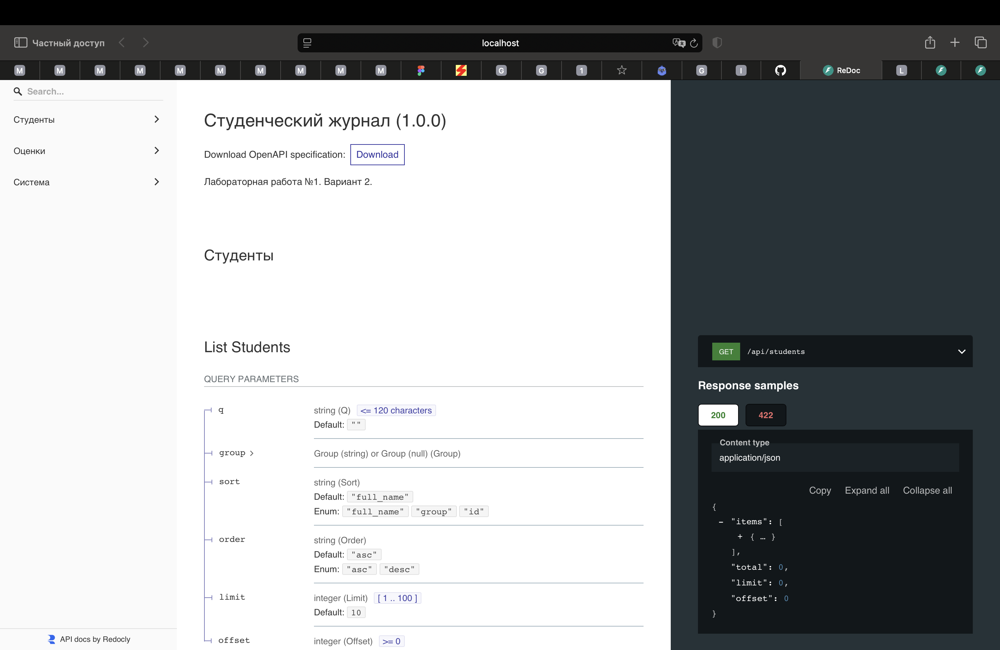
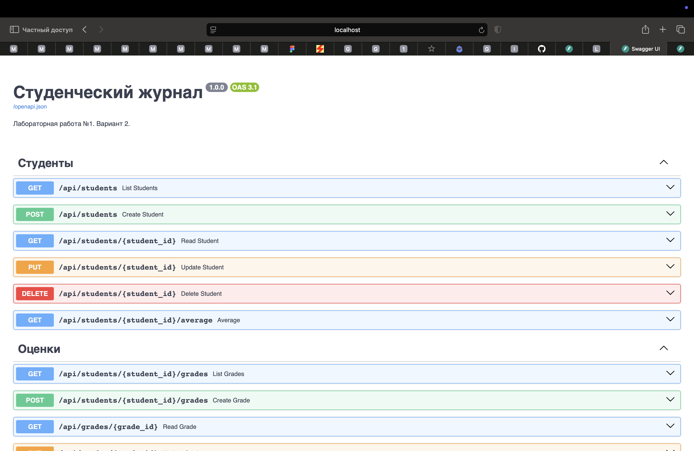

# Отчёт по лабораторной работе №1

Репозиторий проекта: [https://github.com/Shark10000/student-journal](https://github.com/Shark10000/student-journal)
**Тема:** разработка REST API. **Вариант 2:** API студенческого журнала.

## Цель

Разработать API для учёта студентов и оценок, изучить HTTP-методы, маршрутизацию, сериализацию, валидацию и хранение в базе данных.

## Реализация

Язык Python, фреймворк FastAPI, ORM SQLAlchemy, база SQLite. Структура backend основана на разделении обязанностей, использованном в предоставленном MicroService: роутеры, схемы, ORM-модели, CRUD и подключение к БД. Предметная область реализована заново.

Модель Student: идентификатор, ФИО, группа, уникальный email. Модель Grade: идентификатор, внешний ключ студента, предмет, целая оценка от 2 до 5, дата, комментарий. Связь Student → Grade — один ко многим. При удалении студента удаляются его оценки; внешние ключи SQLite включены.

Созданы 12 операций API (перечень и curl-примеры в README), из них CRUD студентов и оценок использует GET, POST, PUT, DELETE. Дополнительная операция вычисляет средний балл SQL-агрегацией `AVG` и количество оценок `COUNT`. Если оценок нет, возвращаются `null` и 0. Результат округляется до двух знаков.

Реализованы поиск по подстроке ФИО, фильтр группы, фильтр оценок по предмету. Дополнительное условие задания выполнено сортировкой и пагинацией. Поля сортировки ограничены допустимым списком, размер страницы — 1–100. При совпадении значения сортировки порядок стабилизируется ID. Поиск кириллицы в SQLite учитывает регистр.

Валидация Pydantic проверяет длины строк, формат email, тип и диапазон оценки, ISO-дату. Email нормализуется в нижний регистр. БД дополнительно ограничивает уникальность email, значения оценки и ссылки на студентов. Ошибки имеют HTTP-статусы 404, 409 и 422; создание возвращает 201, удаление — 204.

Swagger UI `/docs`, ReDoc `/redoc` и спецификация `/openapi.json` формируются FastAPI. CORS разрешает локальный React-клиент.

## Проверка

Команда: `cd backend && ../.venv/bin/python -m pytest -q`.

Автоматизированные тесты проверяют только валидацию входных данных: пустые обязательные поля, неверный email, неизвестные поля, диапазон и тип оценки, дату, размер страницы, смещение и параметры сортировки. Тестовая БД размещается в памяти и изолирована от рабочей.

## Вывод

Разработано работающее REST API студенческого журнала. Все условия лабораторной выполнены: Python, FastAPI, БД, модели, CRUD, более семи операций, агрегация, валидация, сортировка, пагинация и документация.

## Скриншоты документации API

