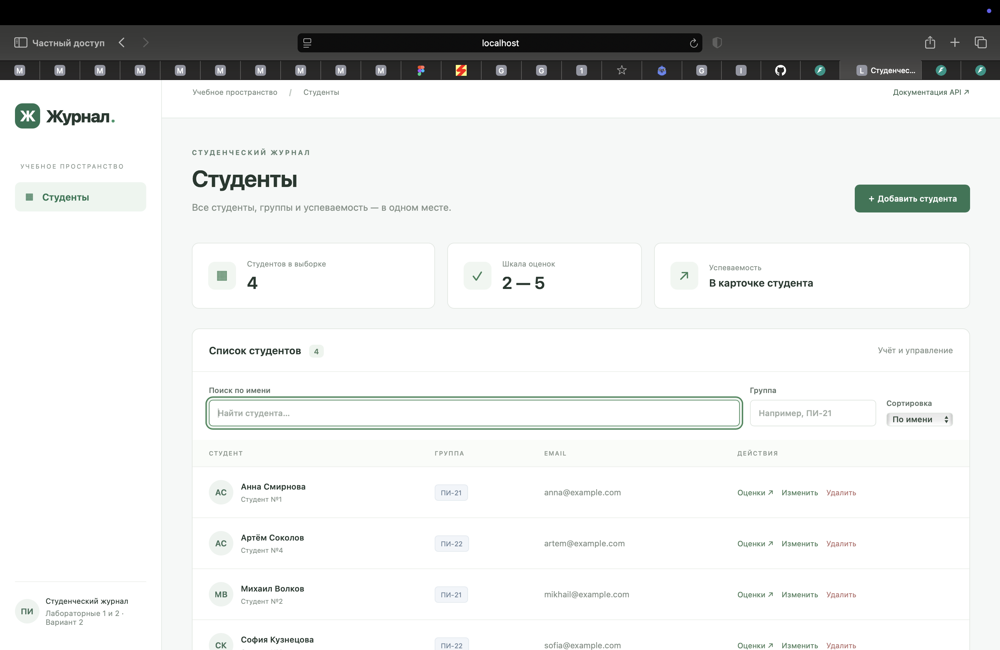
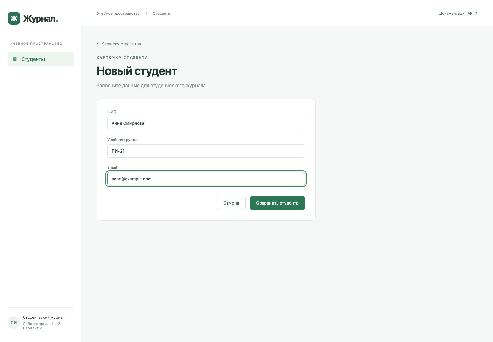
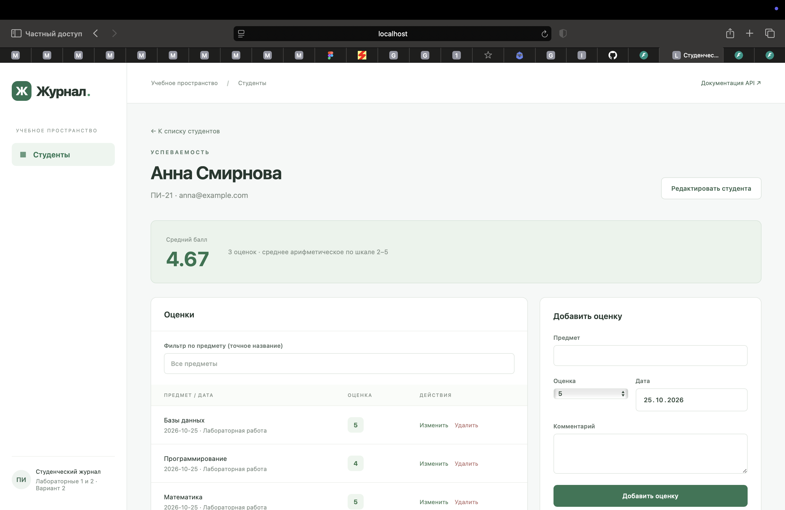
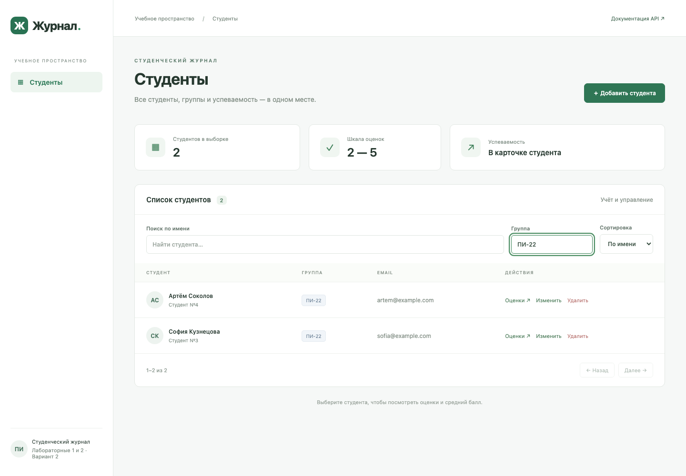
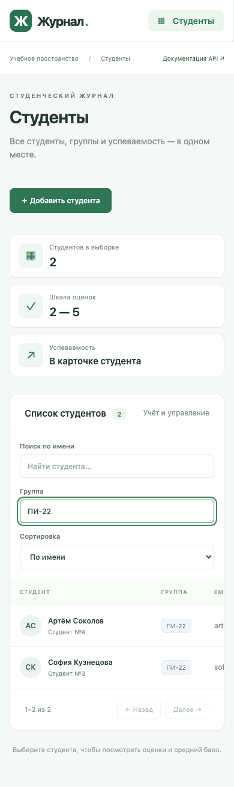

# Отчёт по лабораторной работе №2

Выполнила Астахова Мария Дмитриевна, группа БСТ2551

Дисциплина: Программная инженерия

Репозиторий проекта: [https://github.com/Shark10000/student-journal](https://github.com/Shark10000/student-journal)
**Тема:** интеграция REST API с фронтендом на React. **Вариант 2:** студенческий журнал.

## Цель

Создать React-приложение, которое получает и изменяет данные API лабораторной №1, отображает студентов и оценки, поддерживает поиск и фильтрацию.

## Структура и взаимодействие

Frontend — React + Vite, запросы выполняет стандартный `fetch` из `src/api.js`. Этот модуль сериализует JSON, обрабатывает отсутствие сети, ответы с ошибками и пустой ответ 204. Состояние экранов управляется React hooks. Навигация реализована hash-маршрутами и работает после обновления страницы без дополнительной настройки сервера.

Три основных экрана:

1. `#/` — таблица студентов, поиск по имени, фильтр группы, сортировка и страницы. Здесь доступны переход к оценкам, изменение и удаление студента.
2. `#/new` и `#/students/{id}/edit` — форма создания или изменения студента. Обязательные поля, ограничения длины и HTML-проверка email дополняются серверной валидацией.
3. `#/students/{id}` — данные студента, таблица оценок, фильтр предмета, пагинация, средний балл и форма добавления/изменения оценки.

GET получает списки, карточки и средний балл. POST создаёт студентов и оценки. PUT обновляет данные. DELETE удаляет записи, после подтверждения пользователя. После изменения оценки клиент перечитывает таблицу и среднее, поэтому данные согласованы с сервером. Кнопки отправки блокируются на время сохранения. Предусмотрены состояния загрузки, ошибки и пустого списка, повторная загрузка списка после сбоя.

Основные маршруты API, примеры curl, структура файлов и инструкции запуска приведены в корневом README. Backend используется тот же, что и в лабораторной №1; отдельного дублирующего сервера нет.

## CORS

FastAPI CORSMiddleware разрешает `http://localhost:5173` и `http://127.0.0.1:5173`, методы GET, POST, PUT, DELETE и Content-Type. В dev-режиме Vite проксирует `/api` к backend. Для прямого подключения можно задать `VITE_API_URL=http://localhost:8000/api`; настройка origins описана в README.

## Интерфейс

Оформление выполнено обычным CSS: боковое меню, таблицы, формы, статусы оценок, адаптация для узкого экрана. Поля имеют подписи, ошибки — role=alert, у элементов предусмотрен видимый фокус клавиатуры.

### Список студентов

### Добавление студента

### Оценки и средний балл

### Фильтрация по группе

### Мобильный экран

## Проверка

Сборка: `cd frontend && npm run build`. Backend содержит только тесты валидации входных данных; подробности в отчёте лабораторной №1. Скриншоты показывают интерфейс с работающим API и демонстрационными данными.

## Вывод

React-приложение интегрировано с API лабораторной №1 и выполняет все четыре требуемых HTTP-метода. Есть три экрана, полный цикл работы с записями, поиск и фильтрация, оформление, CORS, инструкции и снимки интерфейса.
